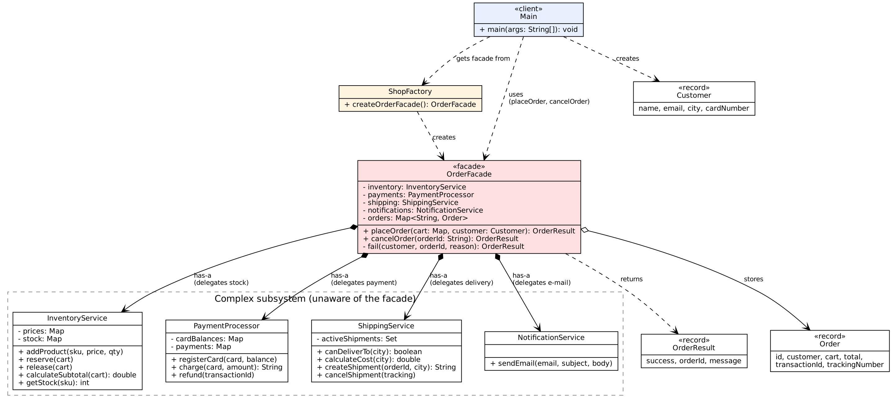

# Assignment 4 — Facade Pattern (Online Order Processing)

**Student:** Zhassyn Zhalynuly  
**Option:** B — Online Order Processing Facade

## Idea

Placing an order in an online shop needs four services working in the right order:

1. `InventoryService` — reserves products in stock
2. `ShippingService` — calculates delivery cost and creates a shipment
3. `PaymentProcessor` — charges the customer's card
4. `NotificationService` — sends an e-mail to the customer

If one step fails, the earlier steps must be undone (for example, reserved stock is
released when the payment is declined). The client should not have to know any of this.

`OrderFacade` hides the whole process behind two methods:

```java
OrderFacade shop = ShopFactory.createOrderFacade();
OrderResult result = shop.placeOrder(Map.of("MOUSE", 2), customer);
shop.cancelOrder(result.orderId());
```

## Project structure

```
src/facade/
├── Main.java                  # client — uses only the facade
├── DirectSubsystemDemo.java   # advanced client — uses subsystem directly
├── OrderFacade.java           # the facade
├── ShopFactory.java           # builds a ready-to-use facade with demo data
├── Customer.java, Order.java, OrderResult.java   # small data records
└── subsystem/
    ├── InventoryService.java
    ├── PaymentProcessor.java
    ├── ShippingService.java
    ├── NotificationService.java
    └── OrderException.java    # the one error type of the subsystem
docs/uml.png                   # UML class diagram
```

## How to run

Requires JDK 17+. Open the folder in IntelliJ IDEA and run `Main`, or from the terminal:

```bash
javac -d out $(find src -name "*.java")
java -cp out facade.Main
```

## Demo scenarios (in `Main`)

| # | Scenario | Result |
|---|----------|--------|
| 1 | Normal order | Stock reserved → card charged → shipment created → e-mail |
| 2 | Not enough money on card | Payment declined → **stock released (rollback)** |
| 3 | Not enough products | Order rejected before anything changes |
| 4 | City without delivery | **Stock released (rollback)** |
| 5 | Cancel order 1 | Shipment cancelled → refund → stock returned → e-mail |
| 6 | Cancel the same order again | Rejected: already cancelled |
| 7 | Negative quantity | Rejected before anything changes |

## UML


